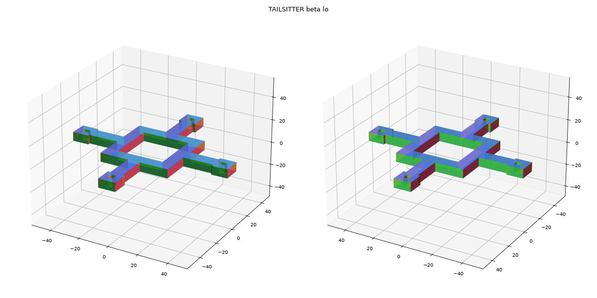
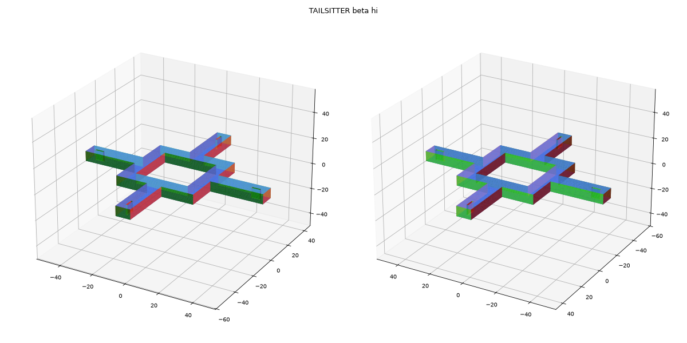
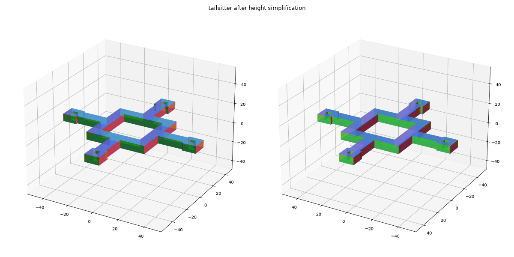
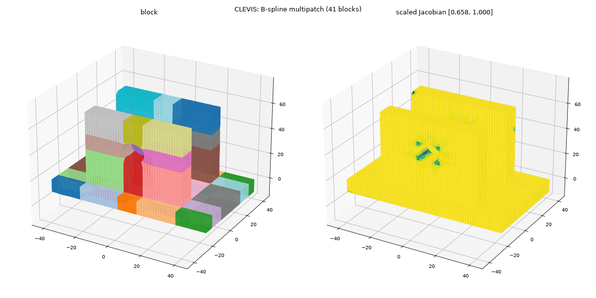
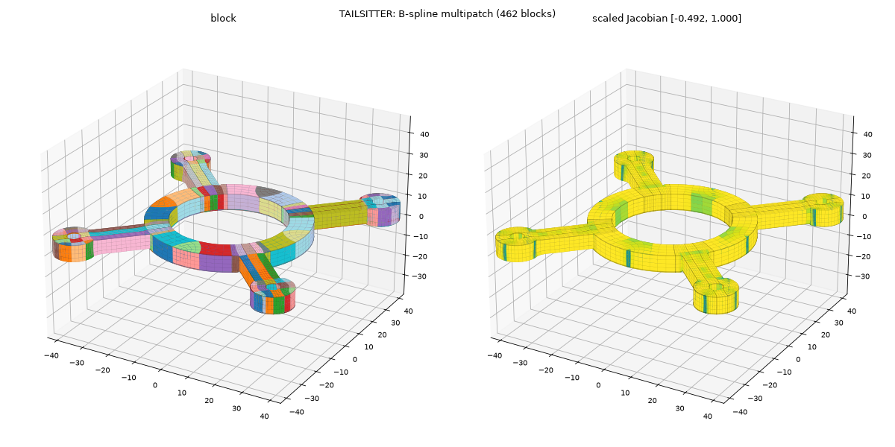
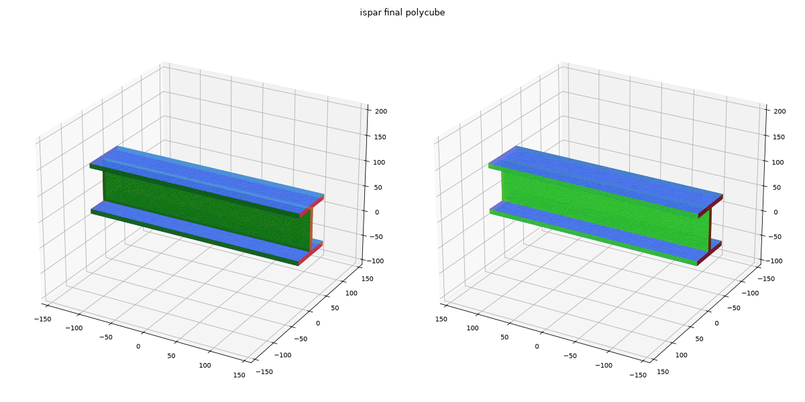
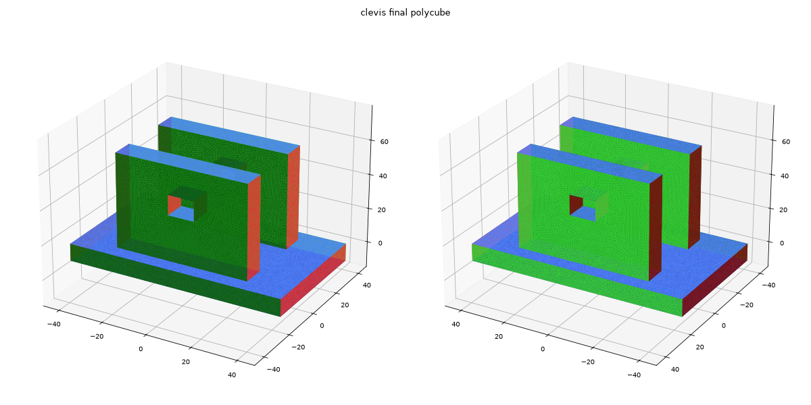
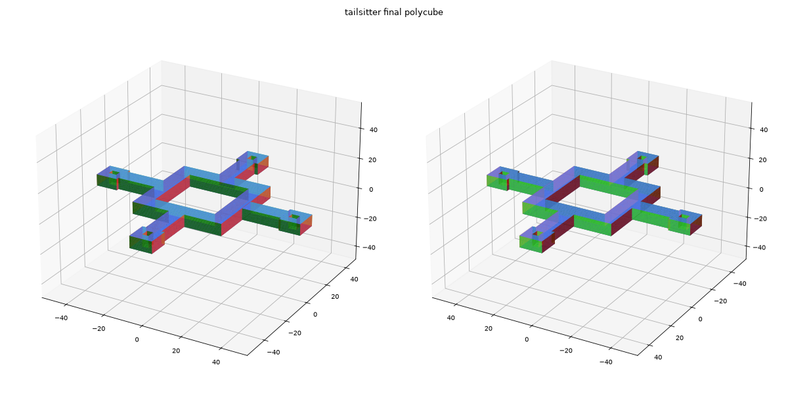

# 实验记录：ℓ1 polycube 流水线（change `add-l1-polycube-pipeline`）

平台：macOS（Apple Silicon，12 核），Release 构建，单线程（没有 OpenMP）。
数据来自 `pcp_cli <model> -o out/<name>` 的 `stats.json`，β 对比来自集成测试 `model_tailsitter_beta`。

## 默认参数

| 参数 | 值 | 说明 |
|---|---|---|
| β（复杂度项） | **0.1** | 起初用 1.0，会把 CAD 模型原有的 90° 棱压圆，CLEVIS 达不到阈值，所以降到 0.1 |
| α0 / α 倍率 | 0.1 / 2 | 和 Huang 2014 相同 |
| ε0 / ε 倍率 / ε 下限 | 1 / 0.5 / 0.01 | |
| 阶段数上限 / 单阶段迭代上限 | 20 / 50 | |
| 平台判据 | 5 步窗口，相对下降 < 0.01 | |
| 误差阈值 | 1e-3 | |
| 四面体尺寸 | `size_factor = 2.0`（最大体积为边长 2×平均表面边长的正四面体）、半径-边比 1.414 | 四面体化后拆分两端点都在边界上的内部边 |
| 线性求解 | 未知数 ≤ 3 万时用 SimplicialLDLT，超过时用 IC-CG（容差 1e-4，每次最多 100 步，相当于截断牛顿） | |
| 四面体翻转 barrier | μ = 1e-4 | 只在 ℓ1 阶段使用 |
| 全局旋转 | 先在立方体对称基本域上以 6° 网格粗搜，再每次迭代做轴角局部修正 | |
| 高度简化最大拉伸比 s | 2 | 见"高度简化"一节 |
| B 样条次数 / 单元尺寸 / 采样 / 光顺权重 | 3 / 0.05 / 每单元每方向 4 个 / 1e-6 | 见"分块与 B 样条拟合"一节 |

完整参数见任意输出目录下的 `params.json`。

## 三个模型的统计

| | I-SPAR | CLEVIS | TAILSITTER |
|---|---:|---:|---:|
| 亏格 | 0 | 2 | 5 |
| 节点 / 四面体 | 17 072 / 57 952 | 37 774 / 163 151 | 50 667 / 214 359 |
| 最小二面角 | 1.60° | 1.56° | 1.68° |
| 全局旋转角 | 0° | 0.02° | 44.92°（绕 Z） |
| 阶段数 / 迭代数 | 0 / 0（输入已是 polycube） | 7 / 134 | 20 / 429 |
| ℓ1 误差 d | 0 | 8.4e-4 | **2.9e-3**（没达到 1e-3） |
| 面积相对差 | 0 | 1.3e-7 | 2.9e-7 |
| ℓ1 后平均 / 最大 ARAP | ≈0 / ≈0 | 8.2e-4 / 1.33 | 3.4e-2 / 11.7 |
| 锯齿清理面数 | 0 | 4 | 54 |
| 面片 / 角点 / 棱线 | 14 / 24 / 36 | 24 / 40 / 60 | 59 / 112 / 168 |
| 面片复形欧拉示性数 | 2 | −2 | −8 |
| 最终映射平均 / 最大 ARAP | ≈0 / ≈0 | 8.3e-4 / 1.42 | 2.4e-2 / 15.4 |
| 翻转四面体（解缠前 → 解缠后） | 0 → 0 | 5 → **0** | 131 → **1** |
| 总耗时 | 2 s | 4.4 min | 22.9 min |

本地按 CI 命令序列复现（`build-ci`，Release）时，三个模型的面片、角点和误差与上表一致：CLEVIS 测试约 10 min，TAILSITTER 约 26 min（含高度简化、分块与拟合），β 对比约 39 min。

耗时主要花在 ℓ1 阶段的线性求解上：TAILSITTER 共 1230 s，其中 CG 求解 896 s，线搜索 184 s，装配 146 s。

### TAILSITTER 的误差曲线

| 阶段 | α | ε | d | ARAP | 迭代 | 结束原因 |
|---:|---:|---:|---:|---:|---:|---|
| 0 | 0.1 | 1 | 0.168 | 0.0012 | 10 | 平台 |
| 2 | 0.4 | 0.25 | 0.117 | 0.0029 | 29 | 平台 |
| 4 | 1.6 | 0.0625 | 0.054 | 0.011 | 50 | 迭代上限 |
| 7 | 12.8 | 0.01 | 0.0085 | 0.031 | 50 | 迭代上限 |
| 10 | 102 | 0.01 | 0.0033 | 0.034 | 47 | 平台 |
| 19 | 5.2e4 | 0.01 | 0.0029 | 0.034 | 13 | 平台 |

第 10 阶段以后误差基本不再下降。剩下的误差集中在 0.5 mm 台阶和小孔附近：这些地方只有一排三角形高，法向很难再压到轴向，再往下压就会碰到防翻折和四面体翻转 barrier。

## 验收结果和已知限制

- **I-SPAR、CLEVIS**：满足原验收标准（d < 1e-3，拓扑检查通过，翻转四面体为 0）。CLEVIS 绕任意轴旋转 30° 后面片数不变；关闭旋转时报告单位矩阵。
- **TAILSITTER**：经确认放宽验收，作为已知限制：
  - d < 5e-3（实测 2.9e-3）；
  - 翻转四面体不超过总数的 0.01%，也就是 21 个以内（实测 1 个）；
  - 旋转角 44.92°，与 45° 的差小于 5°；面片复形欧拉示性数 −8，与亏格 5 一致。
- 后续可以尝试的方向：凹角孔洞附近局部加密网格；给最终映射加单射约束；先对台阶和小孔做几何简化。下一个 change（Chen 2019 的有向图高度简化）也会合并掉一部分台阶，可能顺带改善这里。

## β 对比（TAILSITTER）

集成测试 `model_tailsitter_beta` 的结果，其余参数都是默认值。默认 β = 0.1 那一列来自 `model_tailsitter`。

| | β = 0.1（默认） | β = 0.2 | β = 4 |
|---|---:|---:|---:|
| 阶段数 / 迭代数 | 20 / 429 | 20 / 443 | 20 / 217 |
| ℓ1 误差 d | 2.9e-3 | 4.3e-3 | **0.102** |
| ℓ1 后平均 ARAP | 0.034 | 0.035 | 0.028 |
| 锯齿清理面数 / 同轴冲突合并 | 54 / 0 | 14 / 1 | 409 / 0 |
| 面片 / 角点 / 棱线 | 59 / 112 / 168 | 58 / 112 / 168 | **42 / 80 / 120** |
| 翻转四面体（解缠前 → 解缠后） | 131 → 1 | 144 → 3 | 322 → 5 |
| barrier 停滞事件 | 0 | 0 | 4（约 1080 个 < 5° 的细长三角形） |
| 耗时 | 22.7 min | 23.5 min | 15.5 min |

β = 4 的角点数（80）少于 β = 0.2（112），满足 spec 中“较大 β 的角点数不多于较小 β”的要求。

**台阶处理情况：**

- β = 0.1 和 0.2 时，臂端的 0.5 mm 台阶和小孔都保留成独立的面片。112 个角点里，大部分来自四个臂端的台阶和孔。
- β = 4 时，复杂度项把台阶面拉平，臂端的小台阶并进相邻的大面片，面片从 58 降到 42。代价是台阶附近的三角形被压成细长条，第 6 阶段起触发防翻折 barrier 停滞，误差停在 0.10，远高于阈值。最终映射仍能按面片划分生成合法的 polycube（拓扑检查通过），但几何畸变更大。
- 结论：单靠增大 β 来消除台阶不可取。更合适的做法是保持小 β 得到准确的 ℓ1 结果，再交给下一个 change（Chen 2019 的有向图高度简化），在结构层面合并台阶。

## 高度简化（change `add-chen-height-simplification`）

在结构提取之后，按 Chen et al. 2019 §5 的有向图方法，把能对齐的同轴面片吸附到同一高度，再按新高度重新求解体映射。切割面数 = 各轴不同高度的数量之和。默认最大拉伸比 s = 2。

### 与论文的差异

| 项目 | 论文 | 本实现 | 原因 |
|---|---|---|---|
| 次序约束 | 只有棱线（sharp line） | 棱线边 + **间隔边**（隔着实体或空隙沿轴正对的面）+ **宽度边**（面片内部条带两侧的同轴面） | U 形算例中只靠棱线会把底板压成零厚度（33 个翻转）；CLEVIS 底板顶面的窄带被压没（1129 个翻转） |
| 合并代价 | 式 (8)：合并后相关边的 Σd | Σd 的**增量** | 与式 (7) 的总目标一致；原式偏向连接少的顶点 |
| 单对求解 | Ipopt | 一维凸问题，对导数二分 100 次 | 不引入依赖，结果确定 |
| 保护 | 无 | **翻转回退**：只保留重新映射后翻转数不超过简化前的最长合并前缀（二分） | TAILSITTER 后段的大代价合并（对齐错开的反向面）有 2519 个翻转 |

### 三个模型的结果（s = 2）

| | I-SPAR | CLEVIS | TAILSITTER |
|---|---:|---:|---:|
| 边数：棱线 / 间隔 / 宽度 | 36 / 11 / 15 | 60 / 22 / 28 | 168 / 68 / 94 |
| 切割面 简化前 → 后（x / y / z） | 13 → **10**（2/4/4） | 24 → **17**（6/6/5） | 59 → **49**（23/21/5） |
| 合并：贪心 / 保留 | 3 / 3 | 7 / 7 | 27 / **10** |
| 回退判据的翻转数（简化前 / 保留后，未解缠） | 0 / 0 | 5 / 5 | 129 / 129 |
| 回退用到的映射次数 | 2 | 2 | 7 |
| 实测长度比 | [1.000, 1.000] | [0.997, 1.003] | [0.985, 1.016] |
| 简化后平均 / 最大 ARAP | ≈0 / ≈0 | 8.3e-4 / 1.43 | 2.4e-2 / 13.8 |
| 简化后翻转（解缠前 → 后） | 0 → 0 | 5 → **0** | 129 → **1**（≤ 0.01% 即 21） |
| 简化阶段耗时 | 11 s | 25 s | 122 s |

I-SPAR 和 CLEVIS 保留的合并都是高度原本就几乎相同的面（长度比在 1 ± 0.3% 以内），面片对称的几处被对齐成同一高度，畸变不变。TAILSITTER 简化后剩 1 个翻转单元（解缠没修好），与简化前的最终映射（同样 1 个）相同。

### 最大拉伸比 s 的影响

贪心阶段的切割面数（未回退）：

| s | I-SPAR | CLEVIS | TAILSITTER |
|---:|---:|---:|---:|
| 1.5 | 10 | 17 | 36 |
| 2 | 10 | 17 | 32 |
| 3 | 10 | 17 | 28 |

加上宽度边以后，I-SPAR 和 CLEVIS 上可行的合并只剩高度几乎相同的面，s 不起作用。TAILSITTER 上，s 越大贪心合并越多，但多出来的都是代价大的合并，回退后三种 s 保留的都是同样的前 10 次合并，重新映射的结果完全相同。因此默认值保持 s = 2。

### 已知局限

- **台阶仍然保留**：TAILSITTER 的 0.5 mm 台阶上下层有棱线相连，按约束不能合并，仍会在分块时形成薄层。去除需要改拓扑，另开 change。
- **回退偏保守**：二分假设"翻转数随前缀长度单调"。TAILSITTER 上并不单调：前 19 次合并（59 → 40）也满足判据，二分只找到前 10 次。改进（逐次接受或跳过）需要更多次映射，留作后续。
- **约束靠取样**：间隔边和宽度边都按三角形重心取样，理论上可能漏掉很小的面片对，由回退判据兜底。

## 分块与 B 样条拟合（change `add-block-bspline-fitting`）

流水线最后两步：沿切割面把简化后的 polycube 切成长方体块，再给每块拟合一个三变量 B 样条体。块之间共享公共面上的控制点，所以接缝处 C0 连续。默认参数：3 次，目标单元尺寸 0.05（相对于 polycube 包围盒对角线），每个单元每个方向 4 个采样，光顺权重 1e-6。

### 与 Chen 2019 的差异

| | Chen 2019 | 本实现 | 原因 |
|---|---|---|---|
| 分块 | 把面片所在平面在实体内延伸到表面为止（局部切割） | 每轴所有切割坐标组成**全局网格**，取 polycube 内部的格子 | 全局网格天然没有 T 型连接，相邻块面对面完全重合，共享控制点即可得到 C0；代价是块更多 |
| 体参数化 | 先拟合边界曲面，再用 Coons 体插值内部 | 直接对 polycube → 原模型的四面体映射采样，全局最小二乘拟合样条体 | 一步得到所有块，块间连续由构造保证 |
| 质量 | — | 只报告缩放 Jacobian，不修复 | 控制点优化留到下一个 change |

### 三个模型的结果（默认参数）

| | I-SPAR | CLEVIS | TAILSITTER |
|---|---:|---:|---:|
| 切割坐标（x / y / z） | 2 / 4 / 4 | 6 / 6 / 5 | 23 / 21 / 5 |
| 网格格子 / 块 | 9 / **7** | 100 / **41** | 1760 / **462** |
| 内部面 / 边界面 | 6 / 30 | 62 / 122 | 944 / 884 |
| 最薄块边长 / 对角线 | 2.0e-2 | 5.1e-2 | **7.3e-4** |
| 控制点（去重后） | 2 640 | 5 160 | 17 764 |
| 采样点 | 25 795 | 54 189 | 67 750 |
| 拟合误差 RMS / 最大 | 5.8e-10 / 2.7e-9 | 1.5e-4 / 4.0e-3 | 2.0e-4 / 2.1e-3 |
| 表面采样点 RMS（验收 ≤ 5e-3） | 5.1e-10 | 2.1e-4 | 2.2e-4 |
| 到原表面距离 最大 / 平均 | 2.6e-9 / 1.5e-10 | 7.4e-4 / 6.9e-6 | 1.5e-3 / 5.0e-5 |
| 缩放 Jacobian 最小 / 平均 | 1.000 / 1.000 | 0.658 / 0.999 | **−0.49** / 0.966 |
| 非正 Jacobian 点（块） | 0 | 0 | 29 / 67 750（15 块） |
| C0 最大偏差 | 0 | 0 | 0 |
| 分块 + 拟合耗时 | 0.3 s | 0.5 s | 0.7 s |

误差和距离都除以输入包围盒对角线。三个模型都没有找不到所在四面体的采样点。C0 偏差恰好为 0：公共面两侧求值用的是同一组控制点，基函数在面上只剩这一层控制点起作用。

- **I-SPAR** 本身就是 polycube，映射近似为一个缩放，三次样条可以精确表示，误差只剩光顺项带来的 1e-9 量级。
- **CLEVIS** 的块集中在耳片孔周围。Jacobian 最低的地方在孔边（见下图右侧的深色点），但全部为正。
- **TAILSITTER** 的切割面贯穿整个模型：0.5 mm 台阶等细小高度差延伸成薄层，最薄的块只有对角线的 7.3e-4。29 个非正 Jacobian 点分布在 15 个块里，都在映射畸变大的区域。

### 单元尺寸与光顺权重

用 `profile_fit` 在已有输出上只重跑分块和拟合（RMS 为表面采样点的误差，Jacobian 为非正点数）：

| 单元尺寸 | λ | I-SPAR 表面 RMS | CLEVIS 控制点 / 表面 RMS / 最小 sJ | TAILSITTER 控制点 / 表面 RMS / 非正点（块） |
|---|---|---:|---:|---:|
| 0.1 | 1e-4 | 1.0e-7 | 2 152 / 2.04e-4 / 0.698 | 16 676 / 2.02e-4 / 31（15） |
| 0.1 | 1e-6 | 1.0e-9 | 2 152 / 2.04e-4 / 0.697 | 16 676 / 2.02e-4 / 30（15） |
| 0.1 | 1e-8 | 1.1e-11 | 2 152 / 2.04e-4 / 0.697 | 16 676 / 2.02e-4 / 30（15） |
| **0.05** | **1e-6** | 5.1e-10 | 5 160 / 2.10e-4 / 0.658 | 17 764 / 2.23e-4 / 29（15） |
| 0.05 | 1e-4 | 5.1e-8 | 5 160 / 2.10e-4 / 0.659 | 17 764 / 2.23e-4 / 29（14） |
| 0.05 | 1e-8 | 6.1e-12 | 5 160 / 2.10e-4 / 0.658 | 17 764 / 2.23e-4 / 29（15） |
| 0.025 | 1e-4 | 1.5e-8 | 13 488 / 9.6e-5 / 0.458 | 24 116 / 2.89e-4 / 33（16） |
| 0.025 | 1e-6 | 1.5e-10 | 13 488 / 9.6e-5 / 0.458 | 24 116 / 2.89e-4 / 35（18） |
| 0.025 | 1e-8 | 2.8e-12 | 13 488 / 9.6e-5 / 0.458 | 24 116 / 2.89e-4 / 35（18） |

- **光顺权重**几乎不影响 CLEVIS 和 TAILSITTER，只在 I-SPAR 这种误差本来就极小的情形里成为主要误差。
- **单元尺寸**：加密到 0.025 后 CLEVIS 误差减半，但最小 Jacobian 从 0.66 降到 0.46（样条开始跟随四面体映射在孔边的折角）。TAILSITTER 的误差和非正点数基本不随尺寸变化，问题出在映射本身（薄块、畸变大的区域），不在样条分辨率。
- 默认值保持 0.05 和 1e-6：误差已比验收线低一个数量级以上，控制点数适中。

### 已知局限

- **块多且薄**：全局网格让 TAILSITTER 有 462 个块，其中不少是由台阶延伸出的薄层。合并块（在不产生 T 型连接的前提下）或去除台阶，都留作后续。
- **负 Jacobian**：TAILSITTER 有 15 个块含非正点，需要下一个 change 的控制点质量优化。
- **关闭简化时块会退化**：不做高度简化时，几乎相等的高度（相差 1e-12 量级）会各自成为切割面，产生厚度接近 0 的块（I-SPAR 上最薄的块只有对角线的 1.3e-12）。分块和拟合仍能完成，但这样的块没有实际意义，应当开启简化。
- **G+Smo 未实测**：输出格式按 G+Smo 源码中的读取代码编写，本机和 CI 都没有 G+Smo。README 给出了手动验证的方法。

左图按块着色，右图按缩放 Jacobian 着色（深色为低值）。TAILSITTER 右图中深色的竖条是台阶延伸出的薄块，非正点集中在这些位置。

## 结果预览

图中颜色表示每个面的主轴方向：红 ±X，绿 ±Y，蓝 ±Z，深色为负方向。黄色表示没有对齐到任何轴的面，三张图里都没有。

## 在 ParaView 中查看

1. 打开 `out/<name>/04_polycube.vtu`，选 `Surface With Edges`，按 `arap` 字段着色可以看到畸变分布；用 `Threshold` 过滤 `inverted = 1` 可以找到翻转的四面体。
2. 打开 `03_labels_polycube.vtu`（polycube 上的表面）或 `03_labels_input.vtu`（原模型上的表面），按 `patch` 或 `label` 着色查看面片划分。
3. `02_l1.vtu` 是 ℓ1 变形后、最终映射前的网格，可以和 `04_polycube.vtu` 对比，看最终映射做了多少修正。
